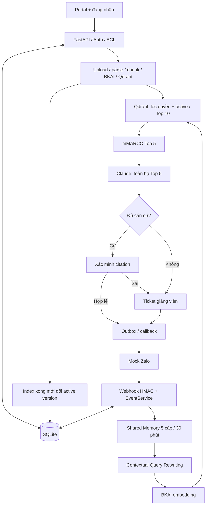

# Kiến trúc, luồng dữ liệu và quyền lớp

Sơ đồ nguồn: [architecture.mmd](architecture.mmd). GitHub hiển thị sơ đồ Mermaid dưới đây.

## Dữ liệu

SQLite giữ users, credentials/session, courses/classes, enrollments có STT, teacher assignments, group bindings, access scopes, documents/versions/chunks, ingestion/cleanup jobs, event/quota/memory, RAG runs/citations/attempts, ticket/FAQ, outbox và audit. Migrations v4, 30 bảng. Mật khẩu dùng Argon2id; token phiên lưu hash. Qdrant giữ vector và text; file gốc nằm trong uploads. Không commit các dữ liệu vận hành này.

## Cấp quyền

- Admin tạo hồ sơ/tài khoản, lớp, sĩ số, phân công giảng viên và liên kết nhóm.
- Giảng viên chỉ quản lý lớp/tài liệu được giao; học viên được gán lớp bằng enrollment. STT không phải mật khẩu hoặc quyền tự khai.
- `ZGROUP_ML01` ánh xạ `ML-DEMO-01`; `ZGROUP_GS01` ánh xạ `GS-KPI-01`. Backend xác minh sender identity và membership trước RAG.
- Lọc scope và active version trước vector search; kiểm tra manifest/hash/citation và quyền lại trước commit/send. Câu hỏi hoặc memory không thể tự cấp scope.
- Quyền áp dụng toàn tài liệu, không có `section_scopes`. Giữ document_id, version tự tăng. SHA-256 phát hiện file không đổi; reindex vẫn hỗ trợ thay cấu hình/model được allowlist.
- Bản cũ tiếp tục phục vụ khi bản mới đang index; chỉ đổi active sau khi hoàn tất. AUTO đã archived, không nằm trong catalog đang dùng.

## Các thành phần

`EventService` ghi sự kiện bền vững, kiểm tra /hoi, ACL/quota, claim job và tạo kết quả/ticket. `Memory Service` lấy tối đa 5 cặp trong cùng nhóm, TTL 30 phút; lịch sử là ngữ cảnh, không là bằng chứng. Rewriter làm rõ câu hiện tại dựa trên lịch sử, không tự chọn quyền/tài liệu.

BKAI/mMARCO chạy CPU local, tải từ model hub và cache. Claude chạy qua gateway Anthropic-compatible. Similarity/rerank chỉ xếp hạng, không còn gate ngưỡng. Model nhận toàn bộ Top 5 hợp lệ và quyết định sufficient; Backend vẫn có quyền chặn quote/citation sai. Worker sử dụng SQLite lease/outbox và retry callback. HMAC giả lập không phải chữ ký Zalo thật.
