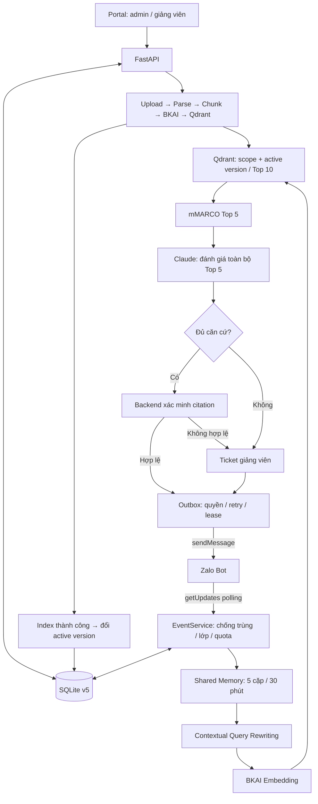

# Kiến trúc hệ thống hiện hành

FastAPI phục vụ portal và polling Zalo Bot trong một process. Bot Token lưu trong `.env`.
Chat/nhóm được admin gắn với một lớp; mọi người trong nhóm dùng được tài liệu của lớp đó.
Không có tài khoản học viên/ghi danh. Tài khoản đăng nhập dành cho admin và giảng viên.

SQLite v5 giữ tài khoản nhân sự, lớp, tài liệu/version/chunk manifest, job, sự kiện,
quota theo sender ID, memory, RAG audit, ticket/FAQ và outbox. Qdrant Local lưu vector/text;
file gốc nằm trong uploads. Source event ID chống xử lý trùng; quyền lớp và citation được
kiểm tra lại trước khi gửi tin. Gửi tin qua HTTP vẫn có rủi ro trùng khi mất ACK sau gửi.

Memory tách theo nhóm và lớp; tối đa 5 cặp/30 phút. Claude nhận toàn bộ Top 5, không có
ngưỡng similarity/rerank chặn trước model. Câu trả lời phải được nguồn hỗ trợ và citation
hợp lệ; thiếu căn cứ chuyển giảng viên. Tài liệu mới chỉ thay active version khi index xong.

Chạy `python scripts/run_rag.py`; portal tại cổng 8002. Polling không cần URL công khai.
Bản hiện tại chưa cấu hình production public hoặc adapter OA/GMF.
