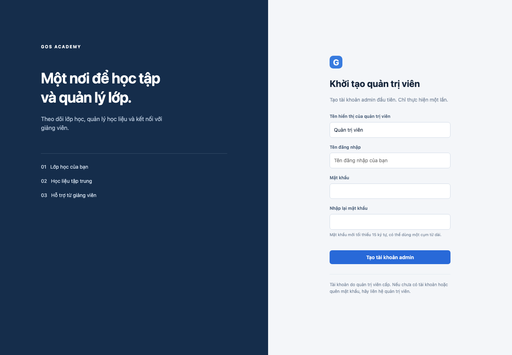
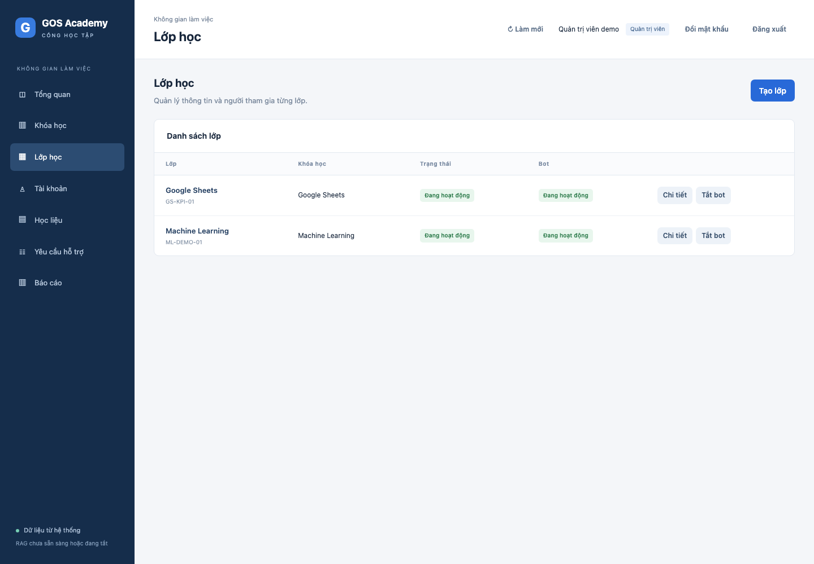
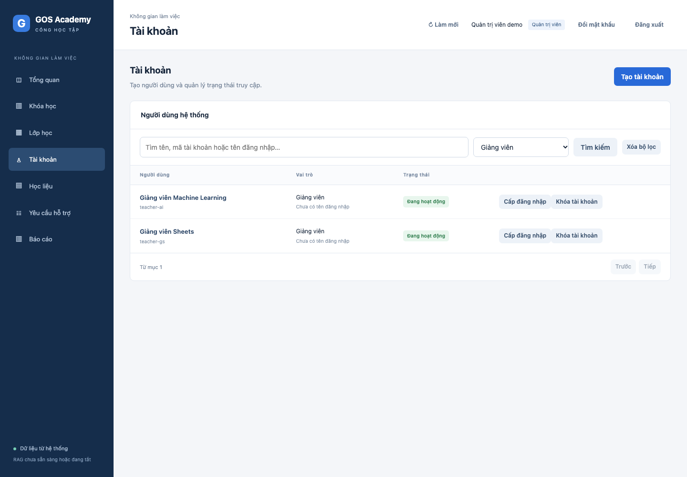
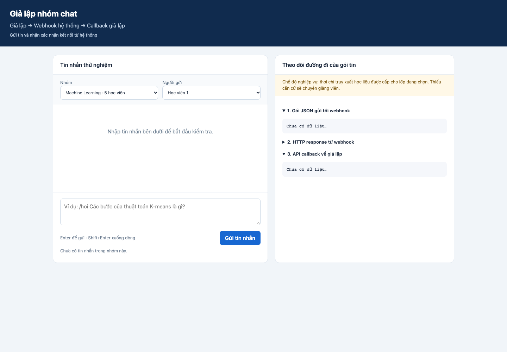

# Hướng dẫn cài đặt, chạy demo và giải thích thành phần

Ngày bàn giao: 12/11/2026. Bản này chạy local, dùng một backend và một giả lập trên cùng máy. Google Docs tương ứng được dẫn trong [GOOGLE_DOCS.md](GOOGLE_DOCS.md).

## 1. Chuẩn bị

Cài Python >=3.11 có wheel tương thích với torch/sentence-transformers. Môi trường đã chạy kiểm thử là macOS/Python 3.14. Cần Internet khi cài thư viện, tải model lần đầu và gọi Claude. Cache model hiện tại khoảng 1 GB; nên có đủ dung lượng cho môi trường Python, học liệu, index và backup. CPU local được dùng cho embedding/reranker, không cần GPU cho demo nhỏ. Chưa có benchmark tải để cam kết số người dùng đồng thời.

Clone repository và đứng tại root có pyproject.toml:

```bash
git clone --branch delivery/20-handover-documentation https://github.com/hoanglongvbhp0703-sys/AI-TEACHING-ASSISTANT.git
cd AI-TEACHING-ASSISTANT
python3 -m venv .venv
source .venv/bin/activate
python -m pip install -e '.[test]'
python scripts/init_local.py
```

Windows PowerShell thay dòng activate bằng `.venv\Scripts\Activate.ps1` và có thể dùng `py -3` để tạo venv. Khả năng cài thư viện trên Windows chưa được kiểm thử trong đợt bàn giao này.

`init_local.py` sinh .env với webhook secret/token ngẫu nhiên nếu chưa có, tạo SQLite/migrations và seed hai lớp. Không overwrite .env cũ, không có mật khẩu admin chung. Không chỉ copy .env.example rồi để secret trống.

## 2. Cấu hình model

Mở .env bằng trình soạn thảo, thêm ba biến sau, thay placeholder bằng key riêng của người vận hành:

```dotenv
CLAUDE_BASE_URL=https://hhtechapi.net
CLAUDE_MODEL=claude-sonnet-4.6
CLAUDE_API_KEY=YOUR_PRIVATE_KEY
```

Key không được commit, chụp màn hình hoặc gửi trong chat. Cấu hình này gọi `/v1/messages` theo Anthropic-compatible protocol. Base URL là HTTPS origin, không thêm `/v1`; provider/model khác phải tương thích giao thức và được xác minh riêng. BKAI và mMARCO là model local; đổi LLM không tự đổi embedding/index.

`run_rag.py` bật RAG, worker nghiệp vụ và callback, chọn đúng cổng 8002/9000; không cần tự chỉnh mọi flag trong .env.example. Cache BKAI/mMARCO được tải theo nhu cầu lần đầu. Key của gateway không thay thế quyền truy cập model hub.

## 3. Nạp tài liệu mẫu

Dừng các backend đang giữ Qdrant trước khi nạp:

```bash
python scripts/load_demo_documents.py
```

Script nạp 14 PDF ML và một DOCX Sheets qua DocumentService và worker thật. Xem log từng file và đợi tất cả active; khi index fail, script thoát báo lỗi và giữ thông tin job để xử lý. PDF chỉ được cấp cho ML, DOCX chỉ cho GS. Chạy lại script trên dữ liệu do chính script tạo sẽ chọn lại đúng document_id theo source_code, không đoán file thay thế.

Nếu dùng UI thay script: đăng nhập admin/giảng viên → Học liệu → Upload → chọn đúng scope lớp → chờ tiến trình index hoàn tất. Bản mới chỉ thay active version sau khi index thành công. Cùng file có thể reindex bằng nút tương ứng khi thay cấu hình được phép.

## 4. Khởi động

```bash
python scripts/run_rag.py
```

- Portal: http://127.0.0.1:8002/portal
- Giả lập: http://127.0.0.1:9000
- Swagger: http://127.0.0.1:8002/docs

Đợi Application startup complete cho cả hai server. Một terminal chạy lệnh trên là đủ; không chạy thêm backend khác cùng DB/Qdrant.

## 5. Tạo admin, tài khoản và lớp

Lần đầu mở portal sẽ thấy form tạo quản trị viên. Tự chọn tên hiển thị, username và mật khẩu tối thiểu 15 ký tự. Sau khi setup, màn hình chuyển sang đăng nhập bình thường.



Đăng nhập admin → Lớp học. Chỉ hai lớp seed đang hoạt động: Google Sheets và Machine Learning. Lớp AUTO cũ được archived nếu nâng cấp từ DB trước.



Vào Tài khoản để tạo giảng viên/học viên, cấp đăng nhập, tìm theo tên có dấu/không dấu, mã hoặc username, lọc vai trò. Không có mật khẩu mặc định để chia sẻ.



Trong chi tiết lớp, phân công giảng viên, thêm học viên hoặc tăng sĩ số theo metadata. STT tự tăng trong từng lớp và không phải thông tin xác thực. Học viên được thêm vào lớp sẽ có định danh giả lập nếu chưa có; định danh đã bị thu hồi không được tự kích hoạt lại. Lớp mới cần Liên kết nhóm để xuất hiện ở Mock Zalo.

## 6. Hỏi đáp và handoff

Trong Mock Zalo, chọn nhóm Machine Learning và một học viên thuộc nhóm. Gửi `/hoi Các bước chính của thuật toán K-means là gì?`. Quan sát tiến trình retrieval/model và câu trả lời có nguồn/trang. RAG có thể handoff nếu chưa đủ nguồn hoặc citation không xác minh được.



Giả lập cập nhật catalog mỗi 5 giây; lịch sử hiển thị tách theo nhóm. Giảng viên không nằm trong selector người gửi học viên. Gửi câu học phí hiện hành để thử thiếu căn cứ. Giảng viên vào Yêu cầu hỗ trợ để phản hồi; kiểm tra callback, ticket và quyền lớp. Các tình huống injection còn thiếu trong báo cáo phải được ghi nhận, không trình bày như đã hoàn thiện.

Ảnh được chụp trên database QA riêng để không đưa tài khoản/dữ liệu vận hành lên repo. Ảnh hướng dẫn hiển thị UI/metadata; không được dùng để khẳng định RAG đã đạt chất lượng cao hơn báo cáo golden.

## 7. Giải thích các node/thành phần

| Thành phần | Vai trò |
|---|---|
| Portal | UI theo admin/teacher/student, gọi API cùng origin |
| Mock Zalo | Đóng gói event, gửi webhook, nhận callback; metadata lấy từ backend |
| FastAPI/Auth | Xác thực session/token, kiểm tra role và scope phía server |
| EventService | Dedup, quyền nhóm, quota, claim và kết quả bền vững |
| SQLite | Nguồn sự thật cho tài khoản, lớp, tài liệu/active, job, memory và ticket |
| Ingestion Worker | Parse/chunk/embed/upsert/verify, đổi active khi thành công |
| BKAI | Encode query/chunk tiếng Việt sau PyVi segmentation |
| Qdrant Local | Lưu vector/text, lọc scope và active trước search |
| mMARCO | Xếp lại Top 10, chọn Top 5; không tự quyết định đủ căn cứ bằng ngưỡng |
| Memory/Rewriter | 5 cặp/30 phút, làm rõ câu hỏi tiếp; history không là bằng chứng |
| Claude | Đọc toàn bộ Top 5, quyết định sufficient và sinh claims/evidence |
| Citation validation | Kiểm tra quote/source và quyền; model true vẫn có thể bị Backend chặn |
| Handoff/FAQ | Chuyển giảng viên; FAQ được duyệt mới vào ingestion |
| Outbox | Gửi callback có retry/lease, kiểm tra lại quyền trước gửi |

Sơ đồ và mô hình dữ liệu: [kiến trúc](../02_kien_truc/KIEN_TRUC.md), `docs/database/` và migrations trong `app/db/`.

## 8. Log và khắc phục

```bash
tail -f data/logs/backend.log data/logs/simulator.log
```

- Cổng bận: Ctrl+C tiến trình cũ, kiểm tra `lsof -nP -iTCP:8002 -iTCP:9000 -sTCP:LISTEN`; chỉ dừng PID đúng dự án.
- Qdrant lock: dừng backend khác hoặc evaluator đang mở cùng data/qdrant; không xóa lock hay index khi đang chạy.
- 401 ở auth/me trước đăng nhập là bình thường; invalid_credentials sau nhập mật khẩu cần kiểm tra role, username và hồ sơ được cấp.
- Upload lưu xong chưa active: xem ingestion progress/job error; kiểm tra worker RAG, cache model, kết nối tải model và dung lượng.
- Có nguồn nhưng không trả lời: xem reason model_evidence_insufficient/quote_not_in_source/invalid_model_output; có nguồn không bảo đảm đủ căn cứ cho mọi ý.
- Giả lập không có lớp mới: liên kết nhóm trước; học viên cần enrollment active và định danh hoạt động.
- Quota 30 câu/ngày/người trên mọi lớp; không đổi ID để vượt quota khi nghiệm thu.

## 9. Dừng, dữ liệu và triển khai

Ctrl+C ở terminal run_rag.py dừng cả hai tiến trình. Giữ data/ để giữ dữ liệu qua restart. Khi backup phải dừng app hoặc dùng SQLite backup nhất quán cho cả nghiệp vụ và Qdrant, kèm uploads. Không copy DB đang ghi theo kiểu chỉ lấy file chính bỏ WAL.

Bản bàn giao là local MVP. Đưa lên Internet cần đổi ràng buộc local URL/env, TLS/reverse proxy, bảo vệ endpoint giả lập/setup, quản lý secret, giới hạn chi phí, backup và monitoring; không chỉ đổi host thành 0.0.0.0. Tích hợp Zalo thật cần adapter và quyền riêng theo đề xuất vận hành.
