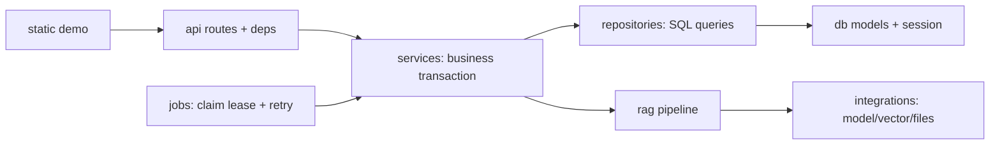

# 04 — Cấu trúc folder hệ thống

Cập nhật 11/11/2026: đã có RAG thật; các file thực thi và trách nhiệm hiện tại nằm tại [kiến trúc RAG](10-rag-implementation.md). Cây thư mục dưới đây là bản thiết kế ban đầu.

Stack giữ đúng SRS: một Python project, FastAPI phục vụ API và static demo; RAG là module nội bộ. **Các folder trong cây đã được tạo; tên file có ký hiệu `(*)` là đề xuất cần viết, chưa phải file đang chạy.** Các tệp Markdown/SQL và `scripts/validate_schema.py` đã có nội dung. Folder rỗng được giữ bằng `.gitkeep`.

## 1. Cây thư mục triển khai

```text
gostech/
├── README.md
├── .gitignore
├── .env.example                 # mẫu config, không chứa credentials
├── pyproject.toml (*)           # dependencies, Python version, lint/test config
├── alembic.ini (*)
├── Dockerfile (*)               # thêm sau khi app local chạy được
├── compose.yaml (*)             # chỉ nếu cần đóng gói; không bắt buộc Qdrant server
├── app/
│   ├── __init__.py (*)
│   ├── main.py (*)              # app factory/lifespan, /demo, routers
│   ├── api/
│   │   ├── deps.py (*)          # DB session, current user, request_id
│   │   └── routes/
│   │       ├── auth.py (*)      # GET /auth/me, demo identity
│   │       ├── webhooks.py (*)  # secret + DTO -> adapter -> event service
│   │       ├── mock.py (*)      # dev-only picker/events/group polling
│   │       ├── courses.py (*)
│   │       ├── classes.py (*)   # members/bot config
│   │       ├── students.py (*)  # quota chính chủ/admin
│   │       ├── documents.py (*) # list/search/create/version/revoke
│   │       ├── jobs.py (*)      # status/retry ingestion
│   │       ├── tickets.py (*)
│   │       ├── faqs.py (*)
│   │       ├── reports.py (*)
│   │       └── health.py (*)
│   ├── core/
│   │   ├── config.py (*)        # env validation, local-only switches
│   │   ├── security.py (*)      # token checks, redaction, hash helpers
│   │   ├── logging.py (*)       # structured log + request_id
│   │   ├── errors.py (*)        # domain error -> API error_code
│   │   └── clock.py (*)         # server UTC + local_date, injectable tests
│   ├── db/
│   │   ├── base.py (*)
│   │   ├── session.py (*)       # SQLAlchemy engine; FK/WAL/busy timeout
│   │   ├── models/
│   │   │   ├── identity.py (*)  # users/courses/classes/membership/identities
│   │   │   ├── document.py (*)  # scopes/access/versions/chunks
│   │   │   ├── event.py (*)     # events/quota/session/messages
│   │   │   ├── handoff.py (*)   # ticket/reply/faq/outbound
│   │   │   ├── job.py (*)      # ingestion/cleanup
│   │   │   └── observability.py (*) # RAG runs/calls/citations/security/audit
│   │   └── migrations/
│   │       ├── env.py (*)
│   │       └── versions/
│   │           └── 0001_initial.py (*) # chuyển DDL thiết kế thành Alembic
│   ├── repositories/
│   │   ├── identity.py (*)
│   │   ├── document.py (*)
│   │   ├── event.py (*)
│   │   ├── quota.py (*)
│   │   ├── memory.py (*)
│   │   ├── handoff.py (*)
│   │   ├── job.py (*)
│   │   └── report.py (*)
│   ├── schemas/
│   │   ├── common.py (*)        # envelope, error, pagination/cursor
│   │   ├── identity.py (*)
│   │   ├── event.py (*)         # external mock DTO + normalized event
│   │   ├── document.py (*)
│   │   ├── handoff.py (*)
│   │   ├── job.py (*)
│   │   └── report.py (*)
│   ├── services/
│   │   ├── event_service.py (*) # orchestration; một handler cho 2 ingress
│   │   ├── access_service.py (*)# group/sender/enrollment/scopes/citations
│   │   ├── quota_service.py (*) # reserve/charge/release/throttle
│   │   ├── memory_service.py (*)# session TTL, 5 cặp hoàn chỉnh
│   │   ├── document_service.py (*) # upload/hash/version/activate/revoke
│   │   ├── ticket_service.py (*)
│   │   ├── faq_service.py (*)   # approve -> official document/job
│   │   ├── outbound_service.py (*) # idempotent outbox + version recheck
│   │   └── report_service.py (*)
│   ├── integrations/
│   │   ├── mock_zalo_adapter.py (*) # external payload -> normalized event
│   │   ├── mock_sender.py (*)   # persist mock outbound, không network Zalo
│   │   ├── file_storage.py (*)  # atomic write, safe path, staging
│   │   ├── vector_store.py (*)  # Qdrant Local lifecycle/filter/upsert/delete
│   │   └── model_clients.py (*) # embedding/reranker/LLM ports + adapters
│   ├── rag/
│   │   ├── schemas.py (*)       # trusted RAG input + 4 outcome DTOs
│   │   ├── ingestion.py (*)     # parse/chunk/embed/upsert/verify, không activate
│   │   ├── chunking.py (*)      # headings/tables/FAQ + token budget
│   │   ├── retrieval.py (*)     # scope/version filter trước search
│   │   ├── reranker.py (*)
│   │   ├── evidence.py (*)      # đủ căn cứ cho ý chính, không chỉ threshold
│   │   ├── generate.py (*)
│   │   ├── citations.py (*)     # validate retrieved set + provenance
│   │   ├── parsers/
│   │   │   ├── pdf.py (*)
│   │   │   ├── docx.py (*)
│   │   │   ├── xlsx.py (*)
│   │   │   └── faq.py (*)
│   │   ├── prompts/
│   │   │   ├── answer_vi.txt (*)
│   │   │   └── evidence_vi.txt (*)
│   │   └── evaluation/
│   │       ├── runner.py (*)
│   │       └── metrics.py (*)   # Recall@k, grounding/handoff, latency/cost
│   ├── jobs/
│   │   ├── event_runner.py (*)
│   │   ├── ingestion_runner.py (*)
│   │   ├── cleanup_runner.py (*)
│   │   └── recovery.py (*)      # lease reclaim, bounded retry, startup scan
│   └── static/
│       ├── demo.html (*)        # chỉ hai tab
│       ├── demo.css (*)
│       └── demo.js (*)          # fetch/poll; không gắn secrets/model SDK
├── scripts/
│   ├── validate_schema.py       # chạy được; chỉ kiểm tra DDL
│   ├── init_data.py (*)         # tạo runtime dirs + migrate
│   ├── seed_demo.py (*)         # idempotent, không ghi đè dữ liệu thật
│   ├── import_sample_events.py (*) # convert fixture cũ -> webhook chuẩn
│   ├── demo_scenarios.py (*)    # ticket/FAQ/quota/report qua API
│   ├── backup_local.py (*)
│   └── evaluate_rag.py (*)
├── tests/
│   ├── unit/                   # parser/commands/clock/redaction/evidence
│   ├── integration/            # SQLite transactions, Qdrant, file, API auth
│   ├── acceptance/             # BE/AG/FE scenario mapping
│   └── fixtures/               # dữ liệu giả lập nhỏ, expected outcomes
├── examples/
│   ├── events/                 # normalized mock input, không credentials
│   └── faq/                    # FAQ JSON/schema và cấu hình xử lý mẫu
├── data/                       # runtime, gitignored trừ .gitkeep
│   ├── gos.db (*)
│   ├── qdrant/
│   ├── uploads/
│   ├── staging/
│   └── exports/
├── docs/
│   ├── architecture/           # review, folder design
│   ├── database/               # design, dictionary, canonical design DDL
│   ├── contracts/              # DTO + transaction/recovery rules
│   └── testing/                # acceptance plan; kết quả thật bổ sung sau
└── [4 PDF + thư mục DOCX/JSON nguồn giữ nguyên vị trí ban đầu]
```

## 2. Ranh giới và quy tắc dependency



- Router validate/authenticate và chuyển DTO; không viết truy vấn SQL hoặc prompt trong router.
- Service quyết định transaction, quyền, state transition. Repository không tự commit và không gọi model. Một service có thể phối hợp nhiều repository trong cùng Unit of Work.
- RAG nhận context đã được Backend cấp quyền; không đọc role/enrollment để tự mở rộng scope và không tự tạo ticket/outbound. Ingestion trả kết quả verified; `document_service` mới chuyển active pointer.
- Integration che chi tiết SDK/Qdrant/file/provider. Không để domain service gọi SDK vendor trực tiếp. Không cần tạo interface trừu tượng cho mọi class; chỉ tạo ở các biên cần thay model/storage/adapter.
- Job runner dùng chính service tương ứng; không triển khai thêm bộ business rules thứ hai. Qdrant client local được khởi tạo một lần trong lifespan và dùng trong cùng process.
- ORM models là cấu trúc persistence, `schemas/` là API DTO, `rag/schemas.py` là contract nội bộ. Không serialize nguyên ORM model ra FE.

## 3. Các folder cố ý không thêm trong MVP

Không tạo project FE riêng, microservices, `node_modules`, Kafka/Redis/Celery, n8n workflows, bảng CRM/doanh thu, agent orchestration hay thư mục Zalo unofficial. Google Sheets/CRM/n8n trong học liệu là **nội dung để bot trả lời**, không phải chức năng phần mềm phải xây.

## 4. Thứ tự triển khai đề xuất

1. `core`, `db`, Alembic và seed identity/class/scope; kiểm tra schema.
2. Webhook/mock adapter, event service, quota/memory và mock sender bằng RAG stub; test dedup/quota/quyền/restart.
3. File parsers + manifest scopes + Qdrant ingestion; version switch/revoke/recovery.
4. Retrieval/rerank/evidence/generate/citations; nối vào event handler, đo chi phí.
5. Ticket/reply/FAQ approval, reports; demo qua Swagger/script.
6. Static hai tab; nghiệm thu toàn luồng và bàn giao video/hướng dẫn.

Các bước là kế hoạch xây ứng dụng, không phải báo cáo đã hoàn thành.
