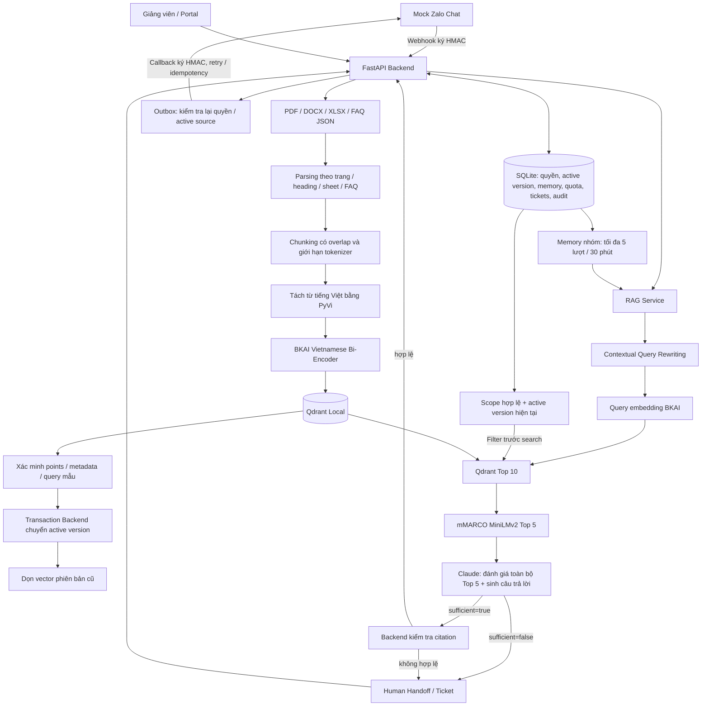

# RAG MVP — kiến trúc và triển khai

Ngày kiểm tra: 11/11/2026. Sơ đồ đã được người dùng chốt là cơ sở triển khai. Đây là RAG chạy thật bằng model local và API sinh câu trả lời, không phải test double.



## Thành phần thực tế

| Thành phần | Mã triển khai |
|---|---|
| Service index/retrieval/rerank/evidence/citation/Qdrant | `app/rag/local_backend.py` |
| BKAI và mMARCO, tải lazy, tách từ PyVi | `app/rag/models.py` |
| Parser và chunking theo cấu trúc | `app/rag/parsers/structure.py` |
| Claude Messages API và schema đầu ra có bằng chứng | `app/rag/provider.py` |
| Quyền tài liệu, version/reindex | `app/services/document_service.py` |
| Memory / TTL / bỏ nguồn không còn hiệu lực | `app/services/memory_service.py` |
| Webhook, quota, gọi RAG và handoff | `app/services/event_service.py` |
| Index/activate/cleanup, outbox và HTTP callback | `app/jobs/runner.py` |
| Chat giả lập, xác thực callback và chống trùng | `app/simulator.py` |
| Chạy portal + RAG + chat cùng bộ dữ liệu | `scripts/run_rag.py` |
| Nạp corpus và đánh giá pipeline thực | `scripts/evaluate_rag.py` |

## Model và cấu hình

- Embedding: `bkai-foundation-models/vietnamese-bi-encoder`, 768 chiều, chuẩn hóa vector, cosine. Tách từ tiếng Việt trước encode theo model card. Chunk được kiểm tra bằng tokenizer của model để tránh bị cắt mất cuối; truy vấn dài vẫn chịu giới hạn tokenizer.
- Reranker: `cross-encoder/mmarco-mMiniLMv2-L12-H384-v1`, sigmoid score. Retrieval lấy 10 point rồi bỏ trùng logical chunk; rerank giữ tối đa 5 chunk. Tài liệu nhiều scope có thể khiến số logical chunk ít hơn 10.
- LLM: request model `claude-sonnet-4.6` tại `https://hhtechapi.net/v1/messages`. Gateway đã nhận và trả response model trùng tên. Không xác minh độc lập model phía sau gateway. Haiku 4.5 trả HTTP 503 trong lần thử; Sonnet 4.6 trả 200.
- Parser MVP: `structure-v1`, chunk_size mặc định 900 ký tự, overlap 100 ký tự. Không ghép vượt ranh giới trang/heading/sheet-row/FAQ. Giới hạn tokenizer có thể làm chunk nhỏ hơn; overlap giảm tương ứng để luôn tiến về phía trước.
- Bằng chứng do Claude đánh giá trên toàn bộ Top 5 trong request sinh trả lời. Không dùng ngưỡng vector/rerank để chặn model; các điểm chỉ dùng xếp hạng.
- Model trả JSON gồm các claim, source number và quote nguyên văn. Thiếu căn cứ, quote không nằm trong chunk, source number sai hoặc output không hợp lệ thì không phát câu trả lời tự do. Backend còn kiểm tra lại citation và quyền trước commit/send.
- CPU mặc định 4 threads. Cache khoảng 1 GB trong `data/models`; vector lưu trong `data/qdrant`. Một collection/model để không trộn embedding spaces. Chỉ model trong allowlist do người vận hành cấu hình được nạp, không chạy remote custom code.

## Quyền, phiên bản và memory

MVP dùng ACL toàn tài liệu qua `document_access`. Section/page/sheet/row chỉ là vị trí trích dẫn. Không dùng `section_scopes`. Nếu nội dung có quyền khác nhau phải tách tài liệu riêng.

Giảng viên chủ động chọn tài liệu để thay file hoặc reindex. Backend giữ document_id, tự tăng version; không so tên/nội dung để quyết định tài liệu thay thế. SHA-256 + cấu hình xử lý phát hiện unchanged. Khi RAG bật, cấu hình mặc định được ghi rõ vào version; đổi model/config hoặc reindex cưỡng bức tạo version mới kể cả cùng file. Upload chỉ hỗ trợ parser revision đã triển khai; giá trị chưa hỗ trợ sẽ fail index và giữ active cũ.

Index mới chỉ activate sau khi xác minh số point, metadata và query mẫu thành công. Đổi active và đánh superseded trong một transaction SQLite, có kiểm tra revision/lease. Cleanup chỉ xóa đúng document_id AND version_id sau đó. Qdrant filter scope + version trước tìm kiếm; kết quả còn đối chiếu manifest/hash/active/ACL trong SQLite.

Memory dùng chung theo lớp/nhóm, tối đa 5 tương tác đã hoàn tất trong phiên 30 phút. Lượt có nguồn đã mất hiệu lực bị loại. Câu ngắn tiếp nối được bổ sung câu hỏi trước khi retrieval; lịch sử không được coi là bằng chứng để model tự trả lời.

## Vận hành

```sh
.venv/bin/python scripts/run_rag.py
```

Chỉ chạy **một process sở hữu Qdrant Local**. Dừng portal cũ đang chiếm 8002 trước khi chạy lệnh trên. Portal ở `http://127.0.0.1:8002/portal`, Mock Zalo ở `http://127.0.0.1:9000`. Chọn nhóm **Machine Learning**, gửi `/hoi Các bước chính của thuật toán K-means là gì?`.

Lớp `ML-DEMO-01` có 14 PDF đã nạp; `teacher-gs` được phân công, `ML-DEMO-STUDENT` là học viên demo, `ML-EVAL-STUDENT` dành cho đánh giá. Các hồ sơ mới không có mật khẩu mặc định; admin cấp đăng nhập qua portal. Quota 30 lượt/ngày vẫn áp dụng; chạy đánh giá tắt throttle 5/phút cho instance đánh giá nhưng không tắt quota. Các lần đánh giá đầu đã ghi usage vào học viên seed HV_GS_01; các lần chạy script mới dùng ML-EVAL-STUDENT. Không xóa/reset lịch sử để che lượt đã dùng.

Chạy lại nạp/evaluate (có gọi model và tính phí gateway):

```sh
.venv/bin/python scripts/evaluate_rag.py --import-only
.venv/bin/python scripts/evaluate_rag.py
```

Muốn QA cô lập: thêm cùng `--data-dir /private/tmp/gos-rag-qa` cho evaluate và run_rag, thêm `--output` khi cần báo cáo riêng. Không mở evaluator và server cùng một Qdrant path đồng thời. Tài liệu scan/ảnh/công thức chưa có OCR; parser báo lỗi nếu hoàn toàn không có text.

`run_portal.py` sử dụng `RAG_ENABLED` trong `.env`; `run_rag.py` bật rõ RAG/business callback. `run_connection_demo.py` vẫn chỉ kiểm tra đường truyền, không gọi RAG. Không chạy hai backend khác cổng nhưng cùng Qdrant path.

Key đọc từ `CLAUDE_API_KEY`, hoặc tên đã có `env_api_ai_claude`, hoặc `ANTHROPIC_API_KEY`. Không đưa key vào frontend/log/báo cáo. `.env.example` có cấu hình không chứa secret.

Log terminal có stage, latency, document/version/chunk count, callback status; không in nội dung câu hỏi hay credentials. SQLite `rag_run_attempts` ghi call started/succeeded/failed/unknown, provider request ID và usage; token input gồm cả token cache nếu provider trả. Chi phí để NULL khi không có bảng giá xác thực, không tự suy ra là 0. HTTP timeout có thể đã phát sinh phí nên đánh unknown; crash có thể để call started cần đối soát, không tự tuyên bố chưa tính phí.

## Phạm vi đã đạt và giới hạn

Đã chạy thật ingestion, dense retrieval, rerank, generation, citation, memory follow-up và handoff. Kiểm tra quyền/version/callback/retry còn có test tự động. Xem [báo cáo thử nghiệm](../testing/11-rag-machine-learning-results.md).

Đây là bản local MVP: Qdrant Local một process, chưa triển khai OCR, distributed workers, streaming hoặc bộ đánh giá grounding do giảng viên chấm độc lập. Quote tồn tại trong nguồn là điều kiện cần, chưa chứng minh mọi claim đều suy ra đúng về mặt ngữ nghĩa. Cần thêm bộ câu hỏi và đáp án chuẩn trước khi tuyên bố chất lượng tổng quát.

Tham khảo triển khai: [BKAI model card](https://huggingface.co/bkai-foundation-models/vietnamese-bi-encoder), [mMARCO model](https://huggingface.co/cross-encoder/mmarco-mMiniLMv2-L12-H384-v1), [Qdrant client](https://github.com/qdrant/qdrant-client).


Cập nhật sau kiểm tra runtime: memory chỉ bổ sung query hỏi tiếp; có vùng evidence review trước khi từ chối sát ngưỡng. Đánh giá mặc định dùng database riêng. [Chi tiết nguyên nhân và xác minh](../testing/14-rag-runtime-diagnosis.md).


Cập nhật mới: đã thay heuristic từ khóa bằng [Contextual Query Rewriting có model](15-contextual-query-rewriting.md) trước query embedding. Đây là trạng thái hiện hành.


[Chính sách đánh giá bằng chứng hiện hành](16-claude-content-evidence.md) thay thế nhánh gate theo điểm trước đây.
