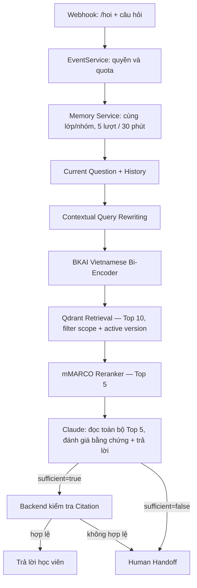

# Contextual Query Rewriting

Đã triển khai theo vị trí người dùng yêu cầu, trước query embedding. Thay thế hoàn toàn quy tắc ghép câu hỏi bằng từ khóa/độ dài trước đây.



## Hành vi

1. EventService giữ câu gốc đã che thông tin nhạy cảm và lấy memory hợp lệ từ SQLite. Không đổi cơ chế quyền lớp, session hay quota.
2. Nếu có history và có nguồn active được phép, gọi model với `current_question` và history tách riêng. History có turn_id, question, answer; tối đa 5 lượt, mỗi trường question/answer tối đa 1.500 ký tự.
3. Model trả JSON có relation, standalone_question, used_turn_ids:
   - `standalone`: câu độc lập hoặc đổi chủ đề. Backend giữ nguyên câu hiện tại, kể cả model đề xuất sửa nó; không nối chủ đề cũ.
   - `follow_up`: viết thành câu độc lập, chỉ dùng turn_id thật sự có trong history. Không nối thô hai câu.
   - `ambiguous`: giữ câu gốc, không đoán chủ đề.
4. Câu đã giải tham chiếu được dùng cho cả BKAI embedding và mMARCO rerank. Query không được cấp quyền hoặc lựa chọn class/scope/active versions; các filter vẫn lấy từ Backend.
5. Khi sinh trả lời, provider nhận `question` gốc, `resolved_question`, memory và SOURCES. Memory/rewrite không được coi là bằng chứng; output vẫn phải có quote/citation được xác minh.

Không có history thì bước rewrite là identity/pass-through, không gọi model. Không có source active được cấp thì handoff trước khi gọi provider để rewrite. Tắt rewrite, timeout, lỗi provider, schema không hợp lệ hoặc model tham chiếu turn_id không tồn tại đều dùng lại câu gốc; không quay về regex ghép câu cũ.

Ví dụ đã thử thật:

| Lịch sử | Câu hiện tại | Phân loại | Truy vấn retrieval |
|---|---|---|---|
| Hỏi hồi quy | Machine Learning là gì | standalone | Machine Learning là gì |
| Hỏi KNN | Nó có nhược điểm gì? | follow_up | Thuật toán KNN có nhược điểm gì? |

## File thực thi

| File | Nhiệm vụ |
|---|---|
| `app/rag/query_rewriter.py` | Schema JSON, prompt rewrite, định dạng history và kiểm tra tham chiếu |
| `app/rag/provider.py` | ClaudeGateway.rewrite và transport/usage dùng chung với generate |
| `app/rag/local_backend.py` | Gọi rewrite trước embed, lưu trace, dùng query mới cho retrieval/rerank và giữ câu gốc cho generation |
| `app/services/memory_service.py` | History theo lớp/nhóm và active-source gate |
| `app/services/progress_service.py` | Tiến trình query_rewrite và phân biệt loại model call |
| `app/db/migrations/versions/0004_query_rewriting.sql` | Audit stage query_rewrite và rag_runs.query_rewrite_json |

`app/rag/query_context.py` nay chỉ còn evidence classification; đã bỏ hàm regex retrieval_question trước đây.

## Model và chi phí gọi

Mặc định dùng cùng model Claude đang cấu hình (`claude-sonnet-4.6`) cho rewrite. Có thể cấu hình model riêng bằng `RAG_REWRITE_MODEL`; tên phải là model ID gateway hỗ trợ. Không mặc định Haiku vì lần kiểm tra trước gateway trả 503.

```text
RAG_REWRITE_ENABLED=true
# RAG_REWRITE_MODEL=claude-sonnet-4.6
RAG_REWRITE_TIMEOUT_SECONDS=20
RAG_REWRITE_MAX_TOKENS=512
```

Khi có history, có thêm tối đa một request rewrite cho mỗi lần xử lý, trước embedding/evidence gate; nó có thể phát sinh phí dù sau đó không gọi model sinh trả lời. Không có history không phát sinh rewrite call. Không tự retry rewrite vô hạn; nếu lỗi thì dùng câu gốc.

Audit ghi `query_rewrite` riêng `generate`, gồm model, token/cache usage, thời gian, provider request ID và trạng thái lỗi/unknown. Reports có `rewrite_usage`, `answer_generation_usage`; `question_usage` vẫn tổng hợp các call. `llm_called` trong progress chỉ nói bước generate; `rewrite_called` là bước rewrite và `provider_called` là có một trong hai.

## Theo dõi và database

- `rag_runs.query_rewrite_json`: trạng thái rewrite, câu gốc, câu độc lập, relation, used_turn_ids, provider_called/error_code. Câu được che secret trước khi lưu.
- GET `/api/v1/events/{key}` cho admin/teacher đã qua kiểm tra lớp xem `query_rewrite`; student không nhận chi tiết trace này.
- Log terminal/file chỉ ghi event ID, status, relation và call stage; không in câu hỏi/history hoặc credentials.
- Thanh tiến trình thêm bước “Viết lại câu hỏi theo ngữ cảnh hội thoại”.
- Schema v4 có 30 bảng, 309 cột. Migration giữ nguyên IDs/usage/thứ tự call audit cũ, thêm stage enum và cột JSON; đã sao lưu và đối chiếu tất cả giá trị cột cũ trước/sau.

## Xác minh

113 kiểm thử tự động và 18 kiểm tra DDL đạt. Có test thứ tự rewrite → embed → rerank → generate; câu độc lập, câu hỏi tiếp, input/output tách biệt, fallback timeout, tham chiếu history sai, không vượt quyền lớp, provider-call accounting riêng và model dùng câu gốc + câu giải tham chiếu khi generate.

Hai luồng thực chạy với BKAI/Qdrant/mMARCO và Sonnet trên snapshot cô lập đều answered có citation: đổi chủ đề ML (3 citations), hỏi tiếp nhược điểm KNN (1 citation). Kết quả: `data/exports/contextual-rewrite-live-check.json`. Không sử dụng quota người dùng thật cho phép thử.

Đây là kiểm chứng hai ca tiêu biểu, không chứng minh model phân loại đúng mọi câu hỏi mơ hồ. Quyền và citation tiếp tục kiểm tra độc lập với kết quả rewrite.

Khởi động lại `scripts/run_rag.py` để nạp code. Không đổi embedding model/file nên không cần index lại tài liệu.


Cập nhật mới: [Claude đánh giá nội dung toàn bộ Top 5](16-claude-content-evidence.md), không còn gate theo điểm.
