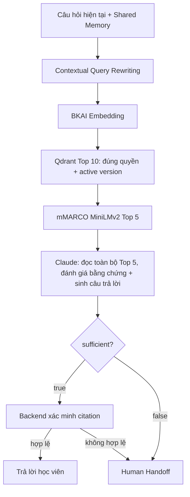

# Claude đánh giá nội dung Top 5 và sinh câu trả lời

Đây là kiến trúc hiện hành, thay thế mọi hướng dẫn gate theo ngưỡng điểm trong các tài liệu trước.



## Thay đổi

- Xóa `evidence_decision()` và file `app/rag/query_context.py`, bỏ các ngưỡng `RAG_EVIDENCE_THRESHOLD`, `RAG_REVIEW_SCORE_FLOOR`, `RAG_REVIEW_VECTOR_FLOOR` khỏi Settings/.env/.env.example.
- Vector score chỉ phục vụ xếp hạng retrieval; rerank score chỉ dùng sắp xếp Top 5. Không dùng chúng để cho phép hoặc từ chối gọi Claude, không truyền điểm làm bằng chứng cho model.
- `LocalRAG.answer()` gửi toàn bộ các chunk trong Top 5 hợp lệ cho `ClaudeGateway.generate()`, kể cả điểm rất thấp. Nếu chỉ có ít hơn 5 chunk hợp lệ thì gửi toàn bộ số có sẵn; không nhân bản hoặc bịa nguồn để đủ 5.
- Chỉ bỏ qua gọi model khi không có source hợp lệ/active/được cấp quyền. Quota, lệnh /hoi, enrollment và quyền nhóm vẫn kiểm tra trước pipeline như trước.

## Hợp đồng Claude

Một request `generate` thực hiện cả đánh giá bằng chứng lẫn sinh câu trả lời, không thêm request chấm gate riêng.

Prompt yêu cầu đọc nội dung của **toàn bộ SOURCES**, không chỉ source đầu. Một chunk đủ thì dùng chunk đó; nhiều chunk bổ sung nhau thì kết hợp; không yêu cầu cả năm đều liên quan hoặc đều có đáp án. Với câu nhiều ý, kiểm tra căn cứ cho từng ý chính; không dùng kiến thức ngoài nguồn để điền phần thiếu.

Nếu đủ:

```json
{"sufficient":true,"claims":[{"text":"ý trả lời","evidence":[{"source":5,"quote":"trích nguyên văn trong source 5"}]}]}
```

Nếu không đủ:

```json
{"sufficient":false,"claims":[]}
```

Backend ánh xạ source 1–5 về manifest, kiểm tra quote nguyên văn và kiểm tra lại scope/active version trước commit/send. Model trả true nhưng citation sai vẫn handoff. Không biến true của model thành quyền truy cập.

## Code và log

- `app/rag/local_backend.py`: gọi Claude với toàn bộ ranked Top 5, xử lý sufficient và xác minh quote.
- `app/rag/provider.py`: prompt nội dung + structured output.
- `app/services/event_service.py`, `outbound_service.py`: handoff và kiểm tra citation/quyền cuối.
- `app/services/progress_service.py`: hiển thị Claude đánh giá; phân biệt model thiếu bằng chứng với Backend không xác minh được citation.

Log `rag_evidence_review` ghi chunks_sent và decision=claude_content_assessment. `rag_content_assessment` ghi sufficient, số claim và số nguồn. `query_rewrite` và `generate` vẫn là hai loại provider call khác nhau; câu không có history không cần model rewrite.

## Kiểm chứng

115 test tự động đạt. Các ca mới kiểm tra:

- Cosine bằng 0 và rerank rất thấp vẫn gọi Claude.
- Chunk đầu không liên quan nhưng source 5 đủ dữ kiện: được trả lời với citation source 5.
- Kết hợp source 2 và 5: backend xác minh cả hai, không bắt buộc dùng toàn bộ nguồn.
- Claude trả sufficient=false: tạo ticket giảng viên.
- Không có nguồn đúng quyền: không gọi model; citation bịa hoặc không còn active bị từ chối.
- Request thực gửi đúng toàn bộ 5 text vào SOURCES, không loại theo điểm.

Thử model thật trên snapshot cô lập tại `data/exports/claude-content-evidence-live-check.json`, không tiêu quota người dùng live:

- Câu K-means nhiều ý của event `8595df8e...`: Claude nhận đủ 5 chunk và tự trả false. Top 5 lúc đó là các đoạn Random Forest/Neural Network/Giới thiệu, chưa có đoạn K-means cần thiết. Đây là vấn đề chất lượng retrieval còn lại; việc bỏ gate không bảo đảm tự tìm đúng nguồn.
- Câu học phí không có trong tài liệu: model nhận đủ 5 và trả false.
- Câu hỏi rõ ý về các bước K-means: Claude nhận đủ 5, trả sufficient=true, Backend xác minh thành công 1 citation và trả answered.

Cần khởi động lại `scripts/run_rag.py`. Không thay model embedding/schema hay nội dung nguồn, không cần reindex để áp dụng thay đổi này.
