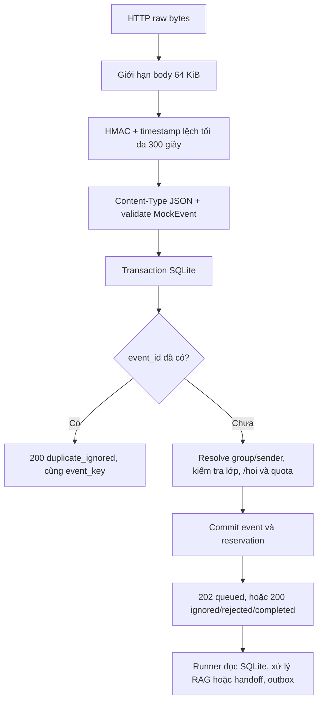

# 09 — Webhook nhận tin nhắn nhóm giả lập

Endpoint: **POST /api/v1/webhooks/mock-zalo**. Đây là hợp đồng mock do dự án định nghĩa; không phải hợp đồng/chữ ký chính thức của Zalo OA/GMF. Khi tích hợp thật cần một adapter theo quyền và đặc tả nền tảng được cấp.

## 1. Luồng xử lý



`202` chỉ xác nhận đã lưu sự kiện và reservation bền vững; không khẳng định model đã trả lời hay gửi Zalo thành công. Worker xử lý ngoài request HTTP. Khi restart, queued hoặc processing hết lease được quét lại theo cơ chế hiện có; không dùng riêng FastAPI BackgroundTasks để giữ công việc.

## 2. Payload

```json
{
  "event_id": "WEBHOOK_DEMO_001",
  "platform": "mock_zalo",
  "group_id": "ZGROUP_GS01",
  "sender_id": "HV_GS_01",
  "sent_at": "2026-11-10T19:00:00+07:00",
  "is_bot_message": false,
  "message": {
    "type": "text",
    "text": "/hoi IMPORTRANGE có đồng bộ ghi chú và bình luận không?",
    "reply_to_event_id": null
  }
}
```

- event_id giữ nguyên qua mọi delivery retry; một câu hỏi mới phải dùng ID mới.
- platform chỉ nhận mock_zalo. class_id/course_id/role/allowed scopes không phải dữ liệu client được phép cấp.
- group_id và sender_id là mã ngoài; Backend resolve từ group_bindings/external_identities rồi kiểm tra enrollment.
- sent_at là thời điểm sự kiện gốc, bắt buộc có timezone; có thể cũ khi retry. Quota dùng thời điểm server tiếp nhận tại Việt Nam.
- message.text tối đa 8.000 ký tự. Bot message/tin không bắt đầu bằng lệnh `/hoi` hợp lệ không vào RAG/quota/memory. `/hoi` rỗng nhận hướng dẫn, không quota.

## 3. Xác minh HMAC

Mặc định `MOCK_WEBHOOK_AUTH_MODE=hmac`. Dùng secret phía server/gateway từ `MOCK_WEBHOOK_SECRET`, không gửi secret trực tiếp trong request HMAC.

```text
Content-Type: application/json
X-Webhook-Timestamp: <Unix seconds hiện tại của lần gửi HTTP>
X-Webhook-Signature: sha256=<64 ký tự hex chữ thường>

signed_data = timestamp_ascii + b"." + raw_body_bytes
signature   = HMAC-SHA256(shared_secret_utf8, signed_data)
```

Ký đúng bytes sẽ gửi, rồi dùng `httpx.post(content=raw_body, ...)`. Không ký một JSON đã serialize rồi lại gửi bằng `json=...` làm thay đổi bytes. Chữ ký được so sánh bằng compare_digest. Timestamp delivery lệch server tối đa 300 giây cả quá khứ/tương lai; không lấy sent_at để kiểm tra độ mới. Retry muộn cần timestamp/chữ ký mới nhưng giữ nguyên event_id và payload nghiệp vụ.

Header timestamp/signature phải xuất hiện đúng một lần. Chữ ký HMAC sai không được fallback sang secret header. Auth được kiểm tra trước parse JSON. Body được giới hạn khi đọc stream, không chỉ tin Content-Length. Cấu hình:

```dotenv
MOCK_WEBHOOK_AUTH_MODE=hmac
MOCK_WEBHOOK_SECRET=
WEBHOOK_SIGNATURE_TOLERANCE_SECONDS=300
WEBHOOK_MAX_BODY_BYTES=65536
```

Script init_local.py sinh secret nếu chưa có .env; không đưa secret thật vào file ví dụ hoặc console. Muốn dùng client local cũ, đặt `MOCK_WEBHOOK_AUTH_MODE=secret` và gửi `X-Webhook-Secret`. Đây là mode tương thích tường minh; không có timestamp/body authentication như HMAC. Sau khi đổi mode, restart server và cấu hình client cùng mode.

## 4. Response và retry

| HTTP | Ý nghĩa | Bên gửi |
|---|---|---|
| 202 | queued: event/quota đã commit | Poll event_key nếu cần kết quả |
| 200 | duplicate_ignored/ignored/rejected/completed | Không retry chỉ vì không có AI answer |
| 401 | Chữ ký/header/timestamp sai hoặc hết hạn | Sửa key/cách ký/đồng hồ, tạo chữ ký mới |
| 413 | Body quá lớn | Giảm payload |
| 415 | Không phải application/json | Sửa Content-Type |
| 422 | JSON/event không hợp lệ | Sửa payload |
| 503 | Secret chưa cấu hình hoặc DB tạm không sẵn sàng | Kiểm tra cấu hình; retry có giới hạn khi lỗi tạm |

Ví dụ receipt:

```json
{
  "data": {
    "event_key": "<UUID>",
    "status": "queued",
    "event_status": null,
    "outcome_code": null
  },
  "error": null,
  "request_id": "<UUID>"
}
```

Duplicate trả event_key cũ, status duplicate_ignored và event_status hiện tại. UNIQUE(platform,external_event_id), transaction BEGIN IMMEDIATE và quota ledger ngăn tác động lặp. Cùng ID nhưng payload khác bị bỏ qua và ghi event_payload_mismatch; không xử lý thành câu hỏi mới. Delivery retry cùng payload trong cửa sổ thời gian là hợp lệ, không bị từ chối chỉ vì chữ ký giống; dedup nghiệp vụ vẫn bảo đảm một lần tiếp nhận.

Khi timeout hoặc lỗi mạng sau commit, bên gửi có thể chưa nhận receipt dù server đã lưu event. Retry bằng ID cũ và chữ ký mới để nhận duplicate_ignored. Gateway thật nên backoff có giới hạn; script demo dưới đây chủ đích gửi hai lần để kiểm tra dedup, chưa phải delivery agent có automatic backoff.

## 5. Code và chạy thử

| File | Nhiệm vụ |
|---|---|
| app/api/routes/webhooks.py | Endpoint, response model, HTTP status và OpenAPI |
| app/integrations/mock_zalo_adapter.py | sign_payload, verify_signature, authenticated_event |
| app/schemas/event.py | MockEvent, MockMessage và WebhookReceipt |
| app/services/event_service.py | Transaction/dedup/access/quota/durable queue và xử lý event |
| app/jobs/runner.py | Xử lý bền vững sau ACK, mock outbox |
| scripts/send_mock_event.py | Ký payload và gửi tới localhost; không in secret/header |
| examples/events/webhook-event.json | Payload demo đúng hợp đồng |
| tests/integration/test_webhooks.py | 25 ca xác minh webhook |

```sh
.venv/bin/python -m uvicorn app.main:app --host 127.0.0.1 --port 8000 --workers 1
.venv/bin/python scripts/send_mock_event.py examples/events/webhook-event.json --repeat 2
```

Lần đầu dùng event_id mới dự kiến trả 202 queued; lần hai trả 200 duplicate_ignored. Nếu đã gửi file này trước đó, cả hai lần đều duplicate; đổi event_id để tạo câu hỏi mới. RAG chưa được cấu hình nên không hứa nhận câu trả lời AI; với kho chưa active sẽ handoff theo luồng hiện tại.

## 6. Kiểm tra đã chạy

50/50 test API đạt (25 ca webhook và 25 ca nghiệp vụ), lint đạt. Các ca webhook bao phủ HMAC độc lập, Unicode, raw-body tampering, timestamp cũ/tương lai/sai định dạng, signature sai/thiếu/lặp, không downgrade, authenticate trước parse, body limit, Content-Type/schema, hai request đồng thời cùng ID, retry ký lại và recovery sau restart.

Tham chiếu: [Python hmac và compare_digest](https://docs.python.org/3/library/hmac.html), [FastAPI đọc Request trực tiếp](https://fastapi.tiangolo.com/advanced/using-request-directly/). Những yêu cầu HMAC/header/tolerance ở trên là quyết định của webhook mock dự án, không suy ra từ API Zalo.
