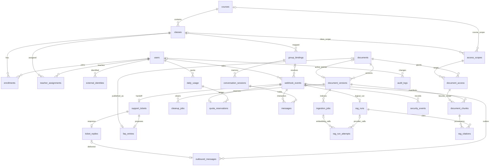

# 02 — Thiết kế database Backend

Mã: GOS-DB-DESIGN-01 · v1.0 · 10/11/2026. Nguồn: SRS Backend §4–12, SRS Agent §4–8, SRS FE §3–6. Các bảng mở rộng phục vụ độ bền dữ liệu là **[ĐX thiết kế]**.

## 1. Phân chia nơi lưu trữ

| Nơi lưu | Nội dung | Không lưu |
|---|---|---|
| `data/gos.db` | Người dùng, quyền, active pointer, jobs, events, quota, memory, ticket, provenance, logs/cost | Vector embedding, secret |
| `data/qdrant/` | Collection `knowledge_chunks_v1`: vector, content và metadata chunk | Quyền tự khai từ FE, lịch sử chat dài hạn |
| `data/uploads/{document_id}/{version_id}/source.ext` | File gốc bất biến của version; FAQ là `source.json` | Tên đường dẫn do người upload tùy chọn |
| `data/staging/{upload_id}/` | File upload tạm đang kiểm tra | Nguồn được retrieval trước khi active |

SQLite là source of truth. Qdrant không có SQL JOIN với SQLite; Backend xây allowlist trước search và kiểm tra lại trước phát phản hồi. `document_chunks` chỉ là manifest provenance và scope, không sao chép vector hoặc toàn nội dung học liệu.

## 2. Quy ước chung

- ID nội bộ `TEXT` UUID do ứng dụng sinh; mã course/class seed có thể là chuỗi ổn định. `source_code` giữ mã tài liệu gốc, ví dụ `DOC-GS-01`; `source_version` giữ `TEST-1.0`, độc lập version số 1/2/3 của hệ thống.
- Ngày giờ trong DB: TEXT ISO 8601 UTC, cố định dạng `YYYY-MM-DDTHH:MM:SS.sssZ` để so sánh/sắp xếp đúng. App chuẩn hóa mọi timestamp, không trộn offset hoặc độ chính xác. `sent_at` từ client chỉ để tham khảo; quota, lease và session dùng server time.
- `local_date`: `YYYY-MM-DD`, tính từ thời điểm **server chấp nhận quota** tại `Asia/Ho_Chi_Minh`. Không reset bằng cron; ngày mới có hàng mới. Retry sau nửa đêm dùng reservation cũ.
- Boolean: INTEGER 0/1; enum: TEXT + CHECK; JSON: TEXT + `json_valid`; cột nullable chỉ khi dữ liệu chưa tồn tại/không xác định. `page=NULL` đối với DOCX/FAQ; giữ section thay vì bịa số trang.
- Chi phí: integer micro-USD (`1 USD = 1.000.000 micros`); `NULL` nghĩa là chưa biết, khác chi phí 0. Tokens chưa biết cũng NULL. Giá/model lấy từ cấu hình được ghi snapshot lúc gọi, không hardcode bảng giá thương mại.
- Không hard-delete dữ liệu đang được lịch sử tham chiếu. FK mặc định NO ACTION; revoke/archive thay delete. `updated_at` và UUID do application điền. Không có trigger tự đổi timestamp.
- `foreign_keys=ON` cho **mỗi connection**; WAL, busy_timeout và transaction ngắn. SQLite chỉ có một write transaction đồng thời. Tham chiếu: [SQLite foreign keys](https://www.sqlite.org/foreignkeys.html), [SQLite transactions](https://www.sqlite.org/lang_transaction.html).

## 3. ERD

Sơ đồ dưới thể hiện quan hệ nghiệp vụ chính; khóa ghép và mọi cột xem DDL/từ điển.



## 4. Nhóm bảng và lựa chọn thiết kế

### 4.1 Tài khoản, lớp, quyền

`users`, `courses`, `classes`, `enrollments`, `teacher_assignments`, `group_bindings`, `external_identities` giữ mô hình trong SRS. Không dùng `classes.teacher_id` song song assignment: một lớp có nhiều giảng viên; assignment là nguồn duy nhất.

`access_scopes` **[ĐX]** chuẩn hóa `course:<id>` hoặc `class:<id>` bằng FK thật, tránh `scope_type/scope_id` trỏ tới tài nguyên không tồn tại. `document_access` có PK `(document_id,scope_id)`. Teacher quản lý class-level khi có assignment active; course-level hoặc tài liệu nhiều lớp chỉ được đổi khi teacher phụ trách tất cả lớp active bị ảnh hưởng, hoặc là admin. Không suy ra quyền quản lý toàn khóa chỉ từ việc dạy một lớp.

App phải kiểm tra role, active user, assignment/enrollment và bot flag. FK không kiểm tra được các điều kiện này. Không tin `class_id`, `course_id`, `allowed_scope_ids`, `role` từ client.

### 4.2 Học liệu, version, chunks và jobs

| Bảng | Trách nhiệm |
|---|---|
| documents | Tài liệu logic; title/topic, status, active pointer, revision chống cập nhật cũ |
| document_versions | Source bất biến; version, SHA-256, file, parser/config/model, chunk/point counts |
| document_access | Phạm vi tối đa tài liệu có thể được cấp |
| document_chunks **[ĐX]** | Point UUID, logical chunk, section/page/sheet, scope và hash; đủ để kiểm chứng citation sau cleanup vector |
| ingestion_jobs | Pipeline parse → chunk → embed → upsert → verify → activate; lease/retry |
| cleanup_jobs **[ĐX]** | Dọn vectors/file độc lập; không bỏ mất việc cleanup khi app crash |

`documents(id,active_version_id)` FK ghép sang `document_versions(document_id,id)` để không trỏ version của tài liệu khác. Chỉ một version status active/document bằng partial unique index. Active pointer và trạng thái versions phải đổi **cùng transaction**. Trigger chặn active pointer trỏ queued/failed, nhưng chưa đủ thay toàn bộ transaction ở service.

SHA-256 chỉ so với bản active để trả `unchanged`; không đặt UNIQUE hash toàn hệ thống hay trong document. File giống V1 nhưng đang thay V2 có thể thành V3 khôi phục nội dung cũ. Phân bổ `version=MAX+1` trong write transaction; UNIQUE(document_id,version) xử lý cạnh tranh. MVP xếp tuần tự upload trên cùng document khi có ingestion live; API trả 409 nếu cố tạo job cạnh tranh.

`chunk_count` đếm logical chunks; `point_count` đếm chunk-scope pairs nên có thể lớn hơn chunk_count. Retry upsert cùng ID, không tạo point mới mỗi lần. Giữ manifest/citation ngay cả khi vector/file cũ bị cleanup. Không đổi source/config/quyền tài liệu của version đang active; thay nội dung hoặc ACL bằng version mới, hoặc revoke tài liệu rồi reindex theo quyền mới.

### 4.3 Event, quota và memory

`webhook_events` là queue bền vững; không thêm event_jobs trùng trách nhiệm. UNIQUE(platform,external_event_id) chống trùng; `event_key` là ID nội bộ. `payload_sha256` giúp phát hiện cùng event ID nhưng payload khác: vẫn không xử lý lại và ghi security event. Không lưu nguyên body chứa secrets; tin thường có thể chỉ lưu metadata tối thiểu, không lưu nội dung, không vào messages/RAG.

`daily_usage.accepted_count` gồm reservation reserved + charged, không gồm released. `quota_reservations` **[ĐX]** PK event_key là ledger chống tính hai lần và chống hoàn hai lần. Cap DB là 30 theo SRS; nếu thay limit bằng cấu hình trong tương lai phải migration CHECK đồng thời. `.env.example` ghi 30, không hứa cấu hình khác tự có hiệu lực.

`conversation_sessions`: một session open/class/group; service đánh dấu expired khi server time **lớn hơn** expires_at, rồi tạo session mới. `messages`: chỉ câu `/hoi` đã nhận và phản hồi; UNIQUE(event_key,message_kind). Lấy 5 **cặp hoàn chỉnh**, không phải LIMIT 5 dòng. Không đưa tin lỗi/blocked/teacher trả lời muộn vào memory mặc định; `memory_eligible` là cờ lựa chọn phía service. Lịch sử lưu vẫn không tự trở thành nguồn kiến thức. Session gắn group binding nội bộ, không dùng external group string đơn lẻ.

### 4.4 Ticket, FAQ và outbound

`support_tickets.event_key` UNIQUE; một event insufficient tạo một ticket. `ticket_replies.ticket_id` UNIQUE là quyết định **[ĐX MVP]**: một câu trả lời chính thức/ticket; nếu cần hội thoại nhiều reply thì migration bỏ ràng buộc này và thêm reply sequence/idempotency key. Dùng revision để chống hai giảng viên ghi đè.

`faq_entries` một đề xuất/ticket, một scope; trả lời ticket chưa là nguồn RAG. Approval tạo tài liệu `source_kind=faq`, một file JSON snapshot, access/version/job. FAQ status approved biểu thị đã duyệt, không có nghĩa đã index. UI/API suy ra queued/indexing/active/failed/revoked từ document/version/job; không lưu cờ indexed trùng nguồn trạng thái.

`outbound_messages` là outbox. Bot answer/handoff/blocked/error đều dùng **cùng message_kind=bot_result** để retry đổi outcome không phát thêm một bot result. `validation_notice` cho `/hoi` rỗng; `policy_notice` cho quota/bot/membership; `teacher_answer` riêng. UNIQUE(event_key,message_kind) bảo đảm mock lưu tối đa một bản tin mỗi loại. Mock status sent nghĩa là bản tin đã lưu cho UI đọc, không phải đã gửi Zalo thật.

### 4.5 RAG, chi phí và truy vết

`rag_runs` một logical run/event, snapshot scopes/versions/memory IDs, result/evidence/latency. `rag_run_attempts` **[ĐX]** ghi từng call query embedding/rerank/generate hoặc ingestion embedding; cột tên attempts giữ ý nghĩa call-level, không phải số lần xử lý toàn event. Mỗi dòng chỉ trỏ một run hoặc một ingestion job. `call_key` nội bộ chống ghi log trùng; không được coi đó là idempotency provider nếu provider không hỗ trợ.

`rag_citations` **[ĐX]** lưu point FK và snapshot title/page/section/excerpt đã che; provenance tra được sau khi Qdrant dọn bản cũ. `outbound.citations_json` là snapshot phục vụ hiển thị; phải sinh từ citations đã validate trong cùng transaction, không nhận từ FE. Backend kiểm tra citation thuộc đúng retrieved set, current active version và scope hiện hành; FK đơn thuần không bảo đảm grounding.

`security_events` ghi blocked/spoof/invalid citation, kể cả lỗi trước khi resolve event (`event_key=NULL`). `audit_logs` **[ĐX]** ghi thay đổi tài liệu/ACL/bot/ticket/FAQ, actor, request_id, diff đã che; entity_id là tham chiếu audit dạng đa loại, cố ý không có FK.

## 5. Qdrant schema và phạm vi truy xuất

Collection khởi đầu `knowledge_chunks_v1`, metric Cosine; vector dimension lấy từ embedding model thực được chọn. Không đoán 768/1536. Toàn collection chỉ một embedding space; đổi model/dimension phải collection mới + reindex, không trộn vector cùng dimension nhưng khác model.

Point ID = UUIDv5(namespace cố định, `version_id|chunk_id|scope_id`). `chunk_id` ổn định trong một version; một chunk chung nhiều scope có nhiều points. Deduplicate sau search theo `(document_version_id,chunk_id)` rồi rerank.

```json
{
  "id": "<deterministic UUID>",
  "vector": ["<float x vector_size>"],
  "payload": {
    "chunk_id": "CH_0003",
    "document_id": "DOC-FAQ-01",
    "document_version_id": "<version UUID>",
    "version": 1,
    "title": "FAQ & quy định lớp học — giả lập",
    "topic": "quy_dinh_lop_hoc",
    "scope_id": "class:GS-KPI-01",
    "section_id": "GS-CLASS-01",
    "section_path": "GS-CLASS-01 > Lớp Google Sheets",
    "page": null,
    "sheet_name": null,
    "row_start": null,
    "row_end": null,
    "content": "<nội dung đã trích xuất>",
    "content_sha256": "<64 hex>",
    "created_at": "2026-11-10T00:00:00.000Z",
    "updated_at": "2026-11-10T00:00:00.000Z",
    "indexed_at": "2026-11-10T00:01:00.000Z"
  }
}
```

Ví dụ trên là minh họa schema, không phải request upsert chạy trực tiếp. Filter có cả hai điều kiện trong `must`: `scope_id match any allowed scopes` **AND** `document_version_id match any active versions`. Tập rỗng thì trả insufficient, không bỏ filter. `scope_id` scalar tránh lỗi kết hợp các giá trị trong array. Xem [Qdrant filtering](https://qdrant.tech/documentation/search/filtering/) cho ngữ nghĩa match/must; cấu trúc client cụ thể cần chốt theo phiên bản dependency khi triển khai.

MVP: FAQ và tài liệu dùng ACL toàn tài liệu qua document_access. Mọi chunk kế thừa tất cả scope của tài liệu; không dùng mapping theo chương. Nếu nội dung có quyền khác nhau, phải tách tài liệu trước khi upload.

## 6. Indexes và truy vấn chính

| Luồng | Khóa/index | Ghi chú |
|---|---|---|
| Dedup event | UNIQUE(platform,external_event_id) | Không dedup bằng text câu hỏi |
| Identity/group lookup | UNIQUE(platform,external_sender_id/external_group_id) | Platform là namespace adapter tin cậy |
| Membership | PK(user_id,class_id) | Thêm status check ở service |
| Quota | PK(user_id,local_date), reservation PK(event_key) | Atomic increment có điều kiện `<30` |
| Ticket inbox | (class_id,status,created_at) | Chỉ lớp được assignment |
| Session memory | partial UNIQUE open session; (session_id,created_at,id) | Dùng thêm event pairing |
| Document versions | UNIQUE(document_id,version), partial UNIQUE active | Active FK cùng document |
| Jobs due | (status,next_attempt_at) | Quét lease hết hạn riêng theo status |
| Outbound polling | (group_binding_id,created_at,id) | Cursor cặp timestamp+id; auth nhóm |
| Reports | (class_id,received_at), các run/call FKs | Tránh nhân bản chi phí khi join citations |

Tìm tên/topic trong SQLite: normalize Unicode + casefold và dấu tiếng Việt ở application cho MVP nhỏ; không giả định `NOCASE` mặc định hiểu tiếng Việt. `LIKE '%...%'` thường không dùng B-tree title; không ghi rằng index này tối ưu substring search. Quy mô lớn mới thêm FTS hoặc cột normalized bằng migration, có benchmark.

## 7. Báo cáo và thời gian

- Received events = COUNT hàng webhook_events theo received_at; đây là **số event duy nhất được lưu**, không phải số HTTP deliveries. Delivery duplicate/normal chat không lưu đầy đủ nếu bị loại sớm; nếu cần tổng HTTP requests dùng structured access logs.
- Accepted = events có accepted_at và quota reservation chưa released; answered/insufficient/blocked/error theo logical run cuối. Một event không vào RAG vì policy không được đếm là RAG error.
- Quota denied = outcome_code quota_exceeded. Ticket count = support_tickets, không nhân số reply/citation.
- Chi phí = SUM provider-call costs, bao gồm retry và ingestion, kèm count call chưa biết chi phí; không COALESCE unknown thành miễn phí. Báo riêng question cost và ingestion cost.
- p50/p95 tính ở Python từ logical run latency; ghi rõ cửa sổ đo và sample count, không suy ra SLA.
- API `from/to` phải có timezone, chuyển thành khoảng UTC `[from,to)`; group by ngày Việt Nam tại application. Không so local midnight với UTC một cách trực tiếp.

## 8. Persistence và mở rộng

Backup SQLite bằng online backup API hoặc lúc app dừng; copy đơn file `.db` khi WAL đang hoạt động có thể thiếu dữ liệu. Uploads, manifest và Qdrant cần snapshot nhất quán: đơn giản nhất dừng writer/demo, backup cả ba cùng một mốc. Khôi phục phải chạy FK/integrity check và thử retrieval active versions. File cũ giữ mặc định cho audit, cleanup_kind=file chỉ bật khi chốt retention; không tự purge trong bản thiết kế.

Chuyển PostgreSQL sau MVP: TEXT UUID → UUID, timestamps → timestamptz, JSON → JSONB, boolean native; đổi `BEGIN IMMEDIATE` sang row locking/upsert, giữ quota ledger/unique keys/outbox/active pointer. Qdrant Server/Cloud cho nhiều process; tách runner khi cần tải lớn. Không bật nhiều Uvicorn workers với Qdrant Local trong MVP.

## 9. Ràng buộc DB và service

DDL bảo đảm NOT NULL/enum/unique/FK, quota 0…30, active pointer cùng document, một session open, một ticket/run/reservation/event, citation point tồn tại. DDL **không tự bảo đảm** role/ACL, status transition, đồng bộ counter-ledger, authenticity, timestamp chuẩn, grounding, TTL, snapshot Qdrant/file, token redaction hoặc outbox current-version check. Những quy tắc này bắt buộc nằm trong service/transaction và cần test nghiệm thu riêng.
